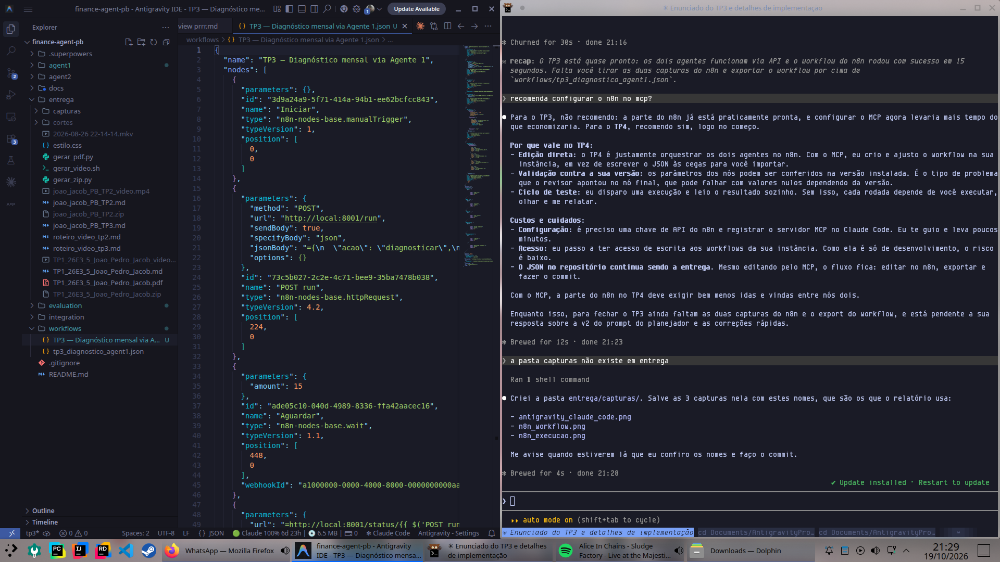
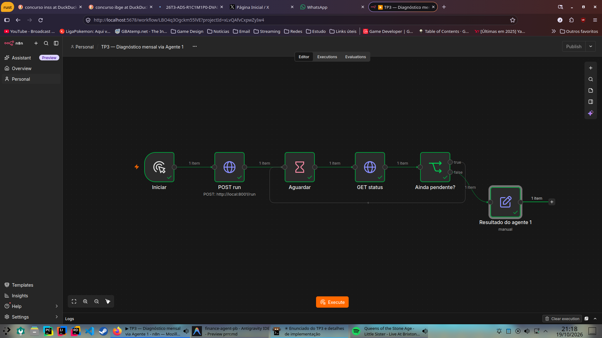
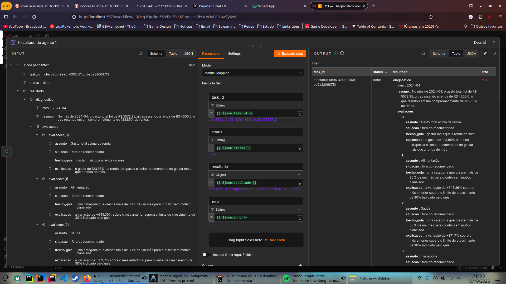

# TP3 — Agentes como serviços REST, segundo agente e primeiro workflow n8n

**Aluno:** João Pedro Jacob · **Disciplina:** 26E3_5 · **Projeto de Bloco — Agentes Inteligentes**
**Repositório:** <https://github.com/AlsornaJP/finance-agent-tp1>
**Vídeo:** <https://drive.google.com/drive/folders/14TclvXp9F6-P7GyieWkeyh52sFXjNosH?usp=drive_link>

## 1. Introdução

Nos TPs 1 e 2 foi construído um agente de finanças pessoais que importa extratos CSV para um SQLite,
classifica transações, responde perguntas com tools e memória e gera diagnósticos mensais em etapas, sob a
regra de que **o LLM nunca calcula**.

O TP3 dá dois passos:

1. o agente existente passa a ser um serviço REST (FastAPI), em `agent1/`;
2. um segundo agente, o **planejador de metas**, é criado como projeto separado em `agent2/`, com sua
   própria API.

Os dois não se conhecem. A orquestração entre eles fica para o n8n, por HTTP; neste TP o n8n aciona o
agente 1 e captura a resposta.

| Pasta | Conteúdo |
|---|---|
| `agent1/` | agente de finanças + API (`api/`) + `CLAUDE.md` |
| `agent2/` | planejador de metas + API (`api/`) + `CLAUDE.md` |
| `integration/` | contrato de API dos dois agentes e exemplos reais (`contrato_api.md`, `exemplos/`) |
| `workflows/` | workflow n8n exportado (`tp3_diagnostico_agent1.json`) |
| `evaluation/` | avaliação final do pipeline de prompts (`avaliacao_final.md`) |

## 2. Ambiente: Antigravity + Claude Code

**Alternativa escolhida:** Claude Code CLI, autenticado com a conta Claude do aluno, rodando no terminal do
sistema ao lado do Antigravity, que é usado como editor do mesmo repositório. Essa é a forma de uso adotada
desde o TP1.

Passos executados:

1. Instalação do Claude Code CLI e login com a conta Claude (`claude`).
2. Abertura da pasta do repositório no Antigravity como workspace, para leitura, revisão e edição manual.
3. Em um terminal do sistema, execução de `claude` na raiz do repositório; o Claude Code trabalha sobre os
   mesmos arquivos que estão abertos no Antigravity.
4. Cada agente tem o seu `CLAUDE.md` na própria pasta. O Claude Code carrega o `CLAUDE.md` da pasta em que
   está trabalhando, então ao editar `agent2/` ele recebe o contexto do planejador, e não o do agente 1.
   Não existe `CLAUDE.md` na raiz.
5. Fluxo sequencial para evitar conflitos de escrita: o Claude Code escreve e testa (`pytest`), o
   Antigravity é usado para revisar e editar, e os serviços são validados separadamente com `curl`.



O desenvolvimento seguiu uma especificação e um plano versionados
(`docs/superpowers/specs/2026-10-19-tp3-design.md` e `docs/superpowers/plans/2026-10-19-tp3.md`),
executados em quatro blocos com revisão do aluno ao fim de cada um.

## 3. Agente 1 — Finanças Pessoais como serviço REST

A lógica do agente ficou intacta: a camada `agent1/api/` só traduz HTTP para os fluxos existentes.

| Arquivo | Papel |
|---|---|
| `api/main.py` | rotas `POST /run`, `GET /status/{task_id}`, `GET /health` |
| `api/schemas.py` | pedidos do `/run` como união discriminada por `acao` (`importar`, `perguntar`, `diagnosticar`) |
| `api/fluxos.py` | pedido → fluxo do agente; resultado como dicionário |
| `api/tarefas.py` | registro de tarefas em memória, estados `pending`, `done`, `error` |

- `POST /run` valida o corpo, cria o `task_id`, agenda a execução com `BackgroundTasks` e responde **202**
  antes de o LLM começar.
- A execução roda uma tarefa por vez (`asyncio.Lock`), evitando escrita concorrente no SQLite e rajadas
  contra o limite gratuito do Gemini.
- Qualquer exceção do fluxo vira `status: "error"` com `"<Tipo>: <mensagem>"`; o serviço não cai.
- O `diagnosticar` devolve, além do diagnóstico, `total_mes` e `gastos_por_categoria` calculados em
  Python — exatamente a entrada do agente 2.
- Única mudança fora de `api/`: um campo `interativo` em `Settings`. A API usa `interativo=False`, e então o
  runner nunca chama `input()` para pedir a próxima chave do OpenRouter (bloquearia o servidor inteiro, mesmo
  rodando num terminal); a tarefa vira `error`.

Respostas reais (em `integration/exemplos/`):

```text
GET  /health                                     → {"status":"ok","agente":"agent1-financas"}
POST /run {"acao":"diagnosticar","mes":"2023-01"} → 202, depois status "error":
     "ValueError: Não há transações para 2023-01. Meses disponíveis: 2024-03, 2024-04."
GET  /status/inexistente                         → 404 {"detail":"Tarefa não encontrada"}
POST /run {"acao":"diagnosticar","mes":"2024-13"} → 422
POST /run {"acao":"perguntar","pergunta":"Quanto gastei com Alimentação em 2024-04?"}
     → 202, depois status "done":
     "Em abril de 2024 você gastou R$ 2853,25 com Alimentação, em 3 transações."
     valores_citados: 2853.25 e 3 ← gastos_por_categoria
```

## 4. Agente 2 — Planejador de Metas

**Responsabilidade.** Dada uma meta de poupança com prazo, a renda e o saldo de um mês de referência e os
gastos desse mês por categoria, diz se a meta é viável, propõe cortes mensais por categoria e projeta o
acumulado mês a mês. O agente 1 descreve o passado ("como foi o mês"); o agente 2 olha para frente.

**Recebe** (`PedidoPlano`): `meta {valor, prazo}`, `mes_referencia`, `total_mes {renda, total_gasto, saldo}`,
`gastos_por_categoria [{categoria, valor_total}]`. Campos extras são ignorados, para aceitar a saída do
agente 1 sem transformação.

**Retorna** (`PlanoDeMeta`): meses disponíveis, economia mensal necessária, sobra atual, valor a cobrir com
cortes, `viavel`, cortes por categoria com justificativa, economia planejada, projeção mês a mês, diferença
para a meta, resumo e `valores_citados`.

**Como respeita "o LLM nunca calcula":**

| Peça | Quem faz |
|---|---|
| `calcular_necessidade_da_meta` (tool) | Python: meses, economia necessária, sobra, quanto falta cobrir |
| `simular_cortes(cortes)` (tool) | Python: valida os cortes, economia planejada, projeção, se atinge a meta |
| escolher onde cortar e justificar | LLM, guiado pela prioridade do prompt (discricionário antes de essencial) |
| `montar_plano` | Python: recalcula todos os números do plano sobre os cortes propostos |

O LLM devolve só uma `PropostaDePlano` (cortes + resumo) via `output_type`; o `PlanoDeMeta` é montado pelo
código. Se o modelo propuser um corte maior que o gasto da categoria, a tarefa termina em `error` — nunca em
um número errado. A sobra atual conta para a meta; com saldo negativo, os cortes cobrem primeiro o déficit.

**Validação real.** Pedido com os números reais de 2024-04 vindos do agente 1 (saldo −R$ 1.073,35) e meta de
R$ 1.200 até 2024-12:

| | Valor |
|---|---|
| Economia necessária | R$ 150,00/mês por 8 meses |
| A cobrir com cortes | R$ 1.223,35/mês |
| Cortes | Lazer 72,00 · Compras 129,90 · Serviços/Assinaturas 61,80 · Alimentação 959,65 |
| Resultado | viável, diferença para a meta 0,00 |

O modelo zerou as três categorias discricionárias (que somam só R$ 263,70) antes de tocar em Alimentação e
não cortou Moradia, Saúde nem Educação.

**Modelos.** Só Gemini: o agente usa tools e `output_type` juntos, combinação que os Gemma ignoram (lição do
TP2). O runner tenta os modelos de `GEMINI_MODELS` em ordem.

**Testes.** 32 testes `pytest` (schemas, simulação, plano, tools, configuração e API); 81 no agente 1. Nas
APIs, o fluxo de LLM é substituído por uma função falsa via `criar_app(executar)`, então os testes rodam em
segundos.

## 5. API dos dois agentes

Resumo; o contrato completo, com schemas campo a campo e exemplos, está em `integration/contrato_api.md`.

| Agente | Método e rota | Entrada | Saída em `done` |
|---|---|---|---|
| 1 (`:8001`) | `POST /run` `acao=importar` | `csv` | `log`, `meses_disponiveis` |
| 1 | `POST /run` `acao=perguntar` | `pergunta`, `sessao_id` | `RespostaFinanceira`, `log` |
| 1 | `POST /run` `acao=diagnosticar` | `mes` | `DiagnosticoMensal`, `total_mes`, `gastos_por_categoria`, `log` |
| 2 (`:8002`) | `POST /run` | `PedidoPlano` | `PlanoDeMeta`, `log` |
| ambos | `GET /status/{task_id}` | — | `{task_id, status, resultado, erro}` |
| ambos | `GET /health` | — | `{status, agente}` |

Códigos: 202 no `/run`, 422 para corpo inválido, 404 para `task_id` desconhecido. Estados: `pending`,
`done`, `error`.

## 6. Os dois `CLAUDE.md`

Cada agente tem o seu (`agent1/CLAUDE.md`, `agent2/CLAUDE.md`), com responsabilidade, invariantes, escopo,
estrutura, tools, endpoints, schemas, ambiente, comandos e convenções. Não há `CLAUDE.md` na raiz: o
enunciado proíbe um arquivo único controlando os dois agentes, e o README da raiz é só um mapa.

Estratégias de context engineering aplicadas nos dois:

| Estratégia | Como aparece | Por quê |
|---|---|---|
| Contexto delimitado | seção "Fora do escopo deste projeto" dizendo que o outro agente e a orquestração não são assunto daquele projeto | impede o Claude Code de "ajudar" importando código ou chamando o outro agente |
| Restrições antes de detalhes | invariantes em lista curta logo após a responsabilidade, antes da estrutura e dos comandos | o que não pode ser violado é lido primeiro e não se perde no meio dos detalhes |
| Referência em vez de cópia | schemas citados por caminho (`api/schemas.py`, `planner/schema.py`) e contrato por link | o código é a fonte da verdade; o `CLAUDE.md` não fica desatualizado quando um campo muda |
| Contexto operacional | comandos exatos a partir da pasta do agente e a regra de não repetir execuções reais de LLM | evita caminhos relativos quebrados e ciclos de desenvolvimento longos esperando o LLM |

## 7. Avaliação final do pipeline de prompts

Documento completo em `evaluation/avaliacao_final.md`. Resumo:

| Variante | Resultado | Decisão |
|---|---|---|
| TP1 P3 → P4 (anatomia de 4 componentes) | categorias fixas respeitadas 9/9 | estrutura de todos os prompts |
| TP2 A/B: sem tools × com tools | precisão numérica 0,667 × 1,00 (2 meses) | com tools |
| TP2 PRRR: assistente v1 × v2 | 6/7, rastreabilidade 0,952 × 7/7, 1,0 | v2 |
| TP3 planejador v1 + recálculo em código | plano real fecha (diferença 0,00) | adotado |

**Critério de decisão:** vence a variante que entrega números garantidamente corretos e rastreáveis.

**Prompt ineficaz diagnosticado:** o assistente v1 somou duas categorias por conta própria quando a pergunta
pediu um total que nenhuma tool fornece. Categoria: **instrução incompleta** — proibia calcular, mas não
dizia o que fazer nesse caso. Correção na v2: regra explícita para números que nenhuma tool fornece e
obrigação de declarar em `valores_citados` todo número do texto. O caso também revelou uma falha da métrica,
corrigida com a rastreabilidade no texto.

Fica registrada uma observação aberta no planejador: o resumo escreve números em formato de código
(`150.0`), por um formato de saída subespecificado no prompt.

## 8. Primeiro workflow n8n

`workflows/tp3_diagnostico_agent1.json`:

```text
Iniciar (manual) → POST run (diagnosticar 2024-04) → Aguardar 15 s → GET status
                        ↑                                              │
                        └──────────── Ainda pendente? ── sim ──────────┘
                                             │ não
                                             ▼
                                   Resultado do agente 1 (status, resultado, erro)
```

O n8n roda em Docker e acessa o agente em `http://local:8001` (container iniciado com
`--add-host=local:host-gateway`).





## 9. Orquestração no TP4

O n8n vai encadear os dois serviços sem que um conheça o outro: importar no agente 1 → diagnosticar no agente
1 → montar o pedido do agente 2 com a meta do usuário mais `total_mes` e `gastos_por_categoria` do
diagnóstico → planejar no agente 2 → entregar diagnóstico e plano juntos, com um ramo de erro para qualquer
`error`. Ordem, repasse de dados e tratamento de falhas ficam no workflow, que é determinístico; os agentes
só conhecem os próprios contratos.

## 10. Decisões técnicas

| Decisão | Justificativa |
|---|---|
| Agente 1 intacto, API como camada fina | preserva a lógica e a avaliação dos TPs anteriores |
| Agente 2 como planejador (e não dividir o agente 1 em "coleta" e "análise") | o coletor seria quase todo determinístico e o analisador dependeria do banco do agente 1; o planejador tem responsabilidade nova e encadeia por HTTP |
| Um `pyproject`, `.venv` e `.env` por agente | independência real entre os projetos |
| Tarefas em memória, uma por vez | suficiente para o TP3 e o TP4; evita concorrência no SQLite e no rate limit |
| Números do plano recalculados em código | o LLM nunca calcula, nem na saída final |
| Testes de API com fluxo falso | ciclo de desenvolvimento em segundos; execuções reais de LLM só uma vez por bloco |

## 11. Limitações

- Tarefas somem quando o serviço reinicia; uma fila persistente seria o próximo passo.
- O planejador foi validado em um caso real; falta um conjunto de avaliação com métricas por caso.
- Extratos de teste sintéticos e pequenos.

## 12. Links

- Repositório: <https://github.com/AlsornaJP/finance-agent-tp1>
- Vídeo: <https://drive.google.com/drive/folders/14TclvXp9F6-P7GyieWkeyh52sFXjNosH?usp=drive_link>
